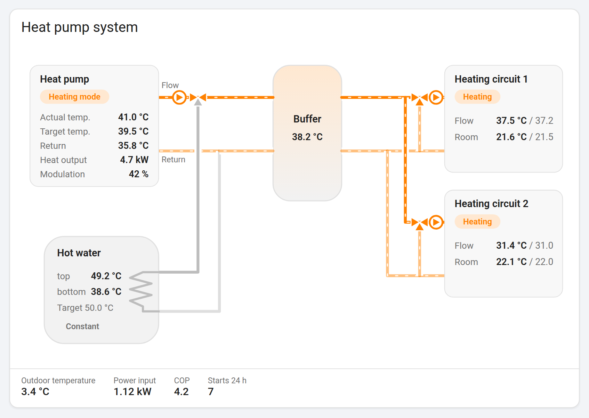

# Hoval Heat Pump Integration (unofficial)


[GitHub repository](https://github.com/gojux/hoval_unofficial) — please
report issues or feature requests there.

Custom component for Home Assistant that connects to a Hoval heat pump
controller via **Modbus TCP** and exposes it as regular Home Assistant
entities — sensors, a domestic hot water (DHW) control, and climate
entities for up to 3 room heating circuits.

Setup is done entirely through the Home Assistant UI — no YAML required.

<picture>
  <source media="(prefers-color-scheme: dark)" srcset="images/schema-card-dark.png">
  
</picture>

The included [system diagram card](#system-diagram-card) shows your
installation at a glance: which components there are, what is running, and
which value belongs where (example values). The included
[Hoval dashboard](#hoval-dashboard) adds history, energy and settings
views around it.

**Contents**

- [Requirements](#requirements) · [Installation](#installation) ·
  [What you get](#what-you-get) · [Buffer sensors](#buffer-sensors)
- [Using the heating circuits](#using-the-heating-circuits-climate-entities)
  · [Experimental functions](#experimental-functions)
- [Using domestic hot water](#using-domestic-hot-water-water_heater-entity)
  · [Using Smart Grid control](#using-smart-grid-control)
- [System diagram card](#system-diagram-card) ·
  [Hoval dashboard](#hoval-dashboard)
- [Options](#options) · [Troubleshooting](#troubleshooting) ·
  [Developer documentation](#developer-documentation)

## Disclaimer

This is an **unofficial**, community-developed integration and is **not
affiliated with, endorsed by, or supported by Hoval**. "Hoval" and any
related trademarks are the property of their respective owner.

This software is provided **"as is", without warranty of any kind**, and
is used **entirely at your own risk**. The author(s) assume **no
liability** for any damage, data loss, equipment malfunction, or other
harm resulting from the use of this integration, including but not
limited to unintended interaction with your heat pump's Modbus
interface.

## Requirements

Home Assistant 2026.9 or newer. The integration uses Home Assistant's
built-in Modbus connection, so no extra Python packages are needed and
no Modbus YAML configuration is required.

A Hoval heat pump with TopTronic E control. Older models with TopTronic T
have no suitable interface and aren't supported.

HovalConnect gateway firmware 2.39 or newer: only from this version on
does the gateway provide the cooling room setpoints, see
[Cooling](#cooling). Hoval recommends keeping the gateway firmware up to
date.

## Installation

### Via HACS

[](https://my.home-assistant.io/redirect/hacs_repository/?owner=gojux&repository=hoval_unofficial&category=integration)

Requires [HACS](https://hacs.xyz) to be installed. Clicking the button
above adds this repository to HACS on your Home Assistant instance;
confirm the dialog there, then install the integration from HACS and
restart Home Assistant.

### Manual

1. Copy `custom_components/hoval_unofficial` into the
   `config/custom_components/` directory of your Home Assistant instance.
2. Restart Home Assistant.

### Setup

1. **Settings → Devices & Services → Add Integration** → search for
   "Hoval Heat Pump Integration (unofficial)".
2. Enter in the dialog:
   - **Name** for this heat pump (used as the device name in HA)
   - **IP address** of the controller
   - **Port** (default: 502)
   - **Modbus device ID** (default: 1)

Home Assistant tests the connection directly during setup. If it fails,
an error message is shown in the dialog.

3. Choose the **heat pump controller**:
   - **WFA200** — Belaria pro, UltraSource, Thermalia 43 series
   - **ECR461** — Thermalia comfort/twin/dual (H), Belaria compact IR,
     Belaria twin A/AR and I/IR, Belaria dual I/IR

   It decides what the heat pump's status codes mean and whether it has
   energy meters (only the WFA200 has them); no register tells them apart.
   The dialog suggests ECR461 if the heat pump has operating hours but both
   energy meters read 0. You can change it later under
   [Options](#options) → Installation.

You can change the connection later via the entry's three-dot menu →
**Reconfigure**, see [Connection](#connection).

## What you get

- **System diagram card** — a dashboard card that draws the heat pump,
  buffer, hot water tank and heating circuits the integration found, with
  their values; see [System diagram card](#system-diagram-card).
- **Hoval dashboard** — a ready-made dashboard with the diagram, the
  thermostats, history, energy and settings, built from what the
  integration found; see [Hoval dashboard](#hoval-dashboard).
- **Sensors** — outdoor temperature, flow/return temperatures, heat
  quantities, operating hours, COP, seasonal performance factor (SPF) (with
  the ECR461 controller, which has no energy meters, the sensors for energy,
  power, COP and SPF are created disabled), the controller's status as readable text in your HA language (e.g. "Heating
  mode" / "Defrost" / "Frost protection") and its error code ("No error" or
  the code shown on the controller, e.g. "W11", "B01" or "E01"). Buffer temperatures where a buffer
  sensor is found, see [Buffer sensors](#buffer-sensors).
- **Diagnostic sensors**, disabled by default — per heating circuit its
  control strategy (e.g. "Weather-compensated with room influence") and its
  current status (e.g. "Normal heating" or "Smart Grid preferred operation,
  heating"); the heat pump's flow rate and the speed of its circulation
  pump, which help to check the hydraulics, e.g. whether a heating circuit
  pumps more water than the heat pump.
- **Domestic hot water (DHW)** — a `water_heater` entity showing tank
  temperature, target temperature, and operating mode. A tank with a second
  sensor at the bottom (SF2) also gets the sensor **Hot water temperature
  bottom**; the `water_heater` entity then shows the top sensor. The
  integration looks for it when it is set up and whenever the options
  under Installation are saved.
- **Room heating circuits (HC1/HC2/HC3)** — `climate` entities for up to
  three heating circuits (not for circuits on constant control, see
  [Control strategies](#control-strategies)), and sensors for each circuit's
  flow temperature, flow setpoint and mixing valve. Heating circuits 2 and 3
  only if they are there, see [Options](#options).
- **Flow setpoint raise** (experimental, see
  [Flow setpoint raise](#flow-setpoint-raise)) — how much higher than the
  circuit's flow setpoint the heat pump heats.
- **Smart Grid control** — two `select` entities and `number` offset
  entities (only where they can have an effect) to drive the controller's
  Smart Grid ("preferred operation") function. Disabled by default; see
  [Using Smart Grid control](#using-smart-grid-control) below.

A value set on a `number` entity is shown right away; its `change_pending`
attribute is `true` until the next poll reads it back from the controller. If
the controller doesn't report it within 90 seconds, the value it reports is
shown again.

## Buffer sensors

Which buffer sensors there are depends on the installation:

- **Buffer temperature WPF** — the heat pump's own buffer sensor.
- **Buffer temperature top / bottom** and **Buffer setpoint** — the two
  buffer sensors and the setpoint of a buffer module (PS, UnitId 142 or
  143).

Each only if the integration finds it: when it is set up and whenever the
experimental functions are opened. A buffer sensor of a found module that
shows no value (e.g. a heating buffer with only the top sensor) is created
disabled, so you can still enable it. With both buffer modules, the heat
pump has a separate heating buffer (143) and cooling buffer (142), and the
entities are named **Heating buffer …** and **Cooling buffer …**.

## Using the heating circuits (climate entities)

### Control strategies

The installer sets each circuit's control strategy on the controller. The
diagnostic sensor **Control strategy heating circuit …** shows it. What the
integration supports depends on it:

| Value | Control strategy | Modes and room setpoints | Show a room temperature | Send a room temperature | Switch room influence on/off | Cooling |
|---|---|---|---|---|---|---|
| 0 | Weather-compensated | ✓ | ✓ | ✓³ (the controller ignores it) | ✓³ (switches to 1) | ✓⁴ |
| 1 | Weather-compensated with room influence | ✓ | ✓ | ✓³ (corrects the flow temperature) | ✓³ (switches to 0) | ✓⁴ |
| 2 | Room control only | ✓ | ✓ | – | – | ✓⁴ |
| 3 | Constant control | –¹ | – | – | – | –¹ ² |
| 4 | Weather-compensated heating + constant cooling | ✓ | ✓ | ✓³ (the controller ignores it) | ✓³ (switches to 5) | ✓² |
| 5 | Weather-compensated heating with room influence + constant cooling | ✓ | ✓ | ✓³ (corrects the flow temperature) | ✓³ (switches to 4) | ✓² |

- **Modes and room setpoints** — the climate entity's modes and target
  temperatures are written regardless of the strategy; how the controller
  uses the room setpoint depends on the strategy.
- **Show a room temperature** — from the controller's room sensor or a Home
  Assistant entity, see below.
- **Send / room influence** — only at strategies 0, 1, 4 and 5, since the
  integration only writes these; room influence needs a room sensor or a
  value that is sent; see
  [Room temperature source](#room-temperature-source-per-circuit).
- **Cooling** — see [Cooling](#cooling).
- ¹ A circuit on strategy 3 has no climate entity, only its sensors. With
  the experimental function [constant control](#constant-control-strategy-3)
  it gets a select for heating / off / cooling and its flow setpoints.
- ² Only with the experimental function **Cooling**; without it, the
  **Cool** mode is only shown while the circuit already cools.
- ⁴ Weather-compensated cooling, if the installer set it up: the
  controller switches between heating and cooling by the outdoor
  temperature. Cooling room setpoints are shown; written only with the
  experimental function **Cooling**.
- ³ Only with the experimental function **Room influence**; without it,
  the integration writes neither, and strategies 1 and 5 are handled like
  0 and 4 (a room influence set by the installer keeps working).
- The [flow setpoint raise](#flow-setpoint-raise) is
  only offered at strategies 0 and 1; its automatic adjustment has only been
  tried with strategy 0. While such a circuit cools, the installer's raise
  applies.


Each circuit has 5 operating modes, mapped onto Home Assistant's climate
controls as follows:

| Controller mode | Home Assistant | Target temperature |
|---|---|---|
| Off | **Off** | not settable |
| Constant | **Heat** | settable (Constant setpoint) |
| Eco | **Auto**, preset **Eco** | settable (Eco setpoint) |
| Week 1 / Week 2 | **Auto**, preset **Week 1** / **Week 2** | shown, not settable (the controller's schedule) |
| – (cooling) | **Cool** | not shown; the flow temperature is set on the number entity **Cooling flow setpoint heating circuit …**, see [Cooling](#cooling) |

- The entity's action shows whether the circuit is in heating or cooling
  operation (**Heating** / **Cooling**, from the circuit's status), not
  whether the heat pump runs right now.
- The program in **Auto** is selected via the **preset** dropdown.
- **Switching to Auto** remembers whichever program (Week 1/Week 2/Eco)
  was last active, so you don't need to re-select it every time.
- After changing a mode or temperature, it can take up to ~30 seconds
  for the Hoval controller to actually apply the change — the display
  updates immediately to show what you requested, and a
  `mode_change_pending` / `temperature_change_pending` attribute (visible
  under "Attributes" in the entity's more-info dialog) shows `true` while
  waiting for the controller to confirm it.
- **After changing the mode** (e.g. switching between Constant and Eco),
  the displayed target temperature can take **a few minutes** to catch up
  with the new mode's actual setpoint — longer than the ~30 seconds
  above. This is because the target temperature shown always reflects
  whichever setpoint the controller currently considers "active", and it
  can take the controller a little while internally to switch over to
  the new mode's setpoint after you change modes. This isn't something
  the integration can speed up or track precisely, since it's a side
  effect of the mode change rather than a change you request directly.

### Room temperature source (per circuit)

By default, a heating circuit's current room temperature isn't shown
(only the target temperature). You can change this per circuit: **Settings
→ Devices & Services → Hoval Heat Pump Integration (unofficial)** → the cog
icon (**Configure**) of the entry → the heating circuit. The form shows the
circuit's current control strategy and room temperature register, and
offers what fits them:

- **Don't show a current temperature** (default)
- **Read the controller's room sensor** — preselected if the circuit has no
  source configured yet and a sensor is detected. Without a sensor, no current
  temperature is shown.
- **Home Assistant entity, display in widget only** — pick any existing
  temperature sensor (e.g. a separate smart thermostat in that room)
- **Home Assistant entity, send to the controller** — additionally writes
  the value to the controller. Only offered with the experimental function
  **Room influence**, if no room sensor is connected to the controller and
  its control strategy is weather-compensated, with or without room
  influence, also with constant cooling (strategies 0, 1, 4 and 5).

Independently of the source, the **Include room sensor in control strategy**
checkbox (also only with the experimental function **Room influence**)
switches room influence on or off: on means "Weather-compensated
with room influence" (1), off means "Weather-compensated" (0); with cooling,
on means "Weather-compensated heating with room influence + constant
cooling" (5), off the same without room influence (4). The controller only
takes the room temperature into account when it's on.
Saving with sending and the checkbox both on first shows the risks below and
asks you to confirm them, every time; without room influence, the controller
ignores the value.

Room influence needs a room temperature: saving with the checkbox on is
refused if no room sensor is detected and no value is being sent, since the
controller would then get 0 as its room temperature. This also applies when
you stop sending while the checkbox stays on.

> **Important:** For the room temperature to correct the flow temperature,
> the parameter **Room temperature compensation (03-007)** must also be set
> above 0 on the Hoval operating module (Service → WEZ → HC1/2/3 → Parameters;
> requires service access, it can't be set via Modbus). The correction is this
> value multiplied by the deviation of the room temperature: 1–3 is weak, 4–6
> medium, 7–10 strong; for underfloor heating, Hoval recommends no more than 4.
> With the default of 0, the controller still switches the heating circuit off
> when the room is warmer than its setpoint, but doesn't correct the flow
> temperature.

While sending, the value is written on every change (at most once per
minute) and at least every 10 minutes. Nothing is sent while the control
strategy is anything other than these four.

If the entity has no usable temperature for 5 minutes (unavailable, or
outside 5–40 °C), or hasn't reported for 2 hours, the circuit's room setpoint
is sent instead while room influence is on. With no deviation, the controller
doesn't correct the flow temperature, as with "Weather-compensated". As soon
as the entity is usable again, its temperature is sent again. After 30
minutes, a repair issue appears.

> **Note:** If Home Assistant itself is down, nothing is sent and the
> controller keeps controlling the circuit with the last value it received.
> A value that is too low raises the flow temperature; a value above the
> setpoint can switch the heating circuit off.

When you stop sending, the room temperature register is reset to 0; the
control strategy only changes if you untick the checkbox (with a room sensor
on the controller, it may stay on). Removing the integration resets the
register too, and restores the control strategy if the integration changed
it.

### Cooling

Cooling is an [experimental function](#experimental-functions): turn on
**Cooling** under the entry's cog icon (**Configure**) →
**Experimental functions**, and only if the installation can cool. Without
it, the integration never writes a cooling setpoint and cooling can't be
chosen; cooling the controller does on its own is still shown (see below).
Turning it off while a circuit cools first
asks for a confirmation, then turns cooling off (flow setpoint 0), checks
that it is off, and only then saves. Removing the integration leaves
cooling as it is, e.g. for another system taking over the heat pump.

Two sensors, **Current cooling power** and **Cooling energy**, are always
created, since the controller can also cool without the integration. They
are enabled once **Cooling** is turned on (unless you disabled them
yourself), otherwise you can enable them under **Settings → Devices &
Services → this integration → Entities**.

A heating circuit cools in one of two ways, depending on its control
strategy set by the installer. The integration reads the strategy when it
is set up; if it changes later, open the entry's cog icon (**Configure**) →
the heating circuit and save once.

#### Weather-compensated cooling (strategies 0, 1 and 2)

If the installer set it up, the controller switches between heating and
cooling by the outdoor temperature on its own; no register tells whether
an installation does this. While the circuit's status shows cooling:

- The climate entity keeps its mode (Off / Heat / Auto), and its action
  shows **Cooling**. Note that **Heat** stands for the controller's mode
  Constant, which then cools.
- The target temperature is the cooling room setpoint: in Constant the
  normal one, with the Eco preset the eco one (shown as stored, without a
  Smart Grid offset); in Week 1 / Week 2 the controller's current room
  setpoint. Changing it writes the cooling room setpoint, only with the
  experimental function **Cooling**; without it, the setpoint is shown but
  can't be changed. The cooling room setpoints need gateway firmware 2.39
  or newer; without them, the current room setpoint is shown.
- A [flow setpoint raise](#flow-setpoint-raise) set by the integration is
  replaced by the installer's raise, see there.

#### Constant cooling (strategies 4 and 5)

"Weather-compensated heating + constant cooling" and "Weather-compensated
heating with room influence + constant cooling": the circuit offers **Cool**
as an additional mode (with the experimental function **Cooling**; without
it, **Cool** is only shown while the circuit already cools, e.g. set on the
controller, and can be left but not chosen again), and a number entity
**Cooling flow setpoint heating circuit …** sets the flow temperature it
cools with (15–25 °C in steps of 1 °C, default 18 °C; the lower bound is raised
to the circuit's minimum cooling flow temperature set by the installer).

- Switching to **Cool** writes that flow temperature to the controller, after
  checking that the control strategy still includes cooling. Before that, the
  circuit's constant heating flow setpoint is set to 0, which cooling
  requires; heating stays weather-compensated and doesn't use that setpoint,
  so it is left at 0. The operating mode is not written: the cooling flow
  setpoint alone turns cooling on. While cooling, no target temperature is
  shown.
- Changing the number entity while cooling sends the new value right away.
- Switching to **Off**, **Heat** or **Auto** first turns cooling off (flow
  setpoint 0) and then writes that operating mode as usual.

## Experimental functions

These functions are still being tried on few installations. They are off
until you turn them on under the entry's cog icon (**Configure**) →
**Experimental functions**; some of them are then set up in a heating
circuit's form. Keep an eye on the heating after turning one on: they can
make the heat pump run less efficiently, or rooms get too cold or too warm.

- **Cooling** — choosing cooling and writing cooling setpoints, see
  [Cooling](#cooling).
- **Room influence** — switching room influence and sending a room
  temperature, see below.
- **Flow setpoint raise** — see below.
- **Constant control (strategy 3)** — see below.

### Room influence

Switching room influence on or off and sending a Home Assistant temperature
to the controller, see
[Room temperature source](#room-temperature-source-per-circuit). Turning the
function off is refused while a heating circuit still sends a room
temperature: change its source in its form first, where leaving room
influence on without a room temperature is refused. Control strategies the
integration switched to room influence are then set back after a
confirmation, checked, and only then is the function turned off.

### Flow setpoint raise

How much higher than a circuit's flow setpoint the heat pump heats (in steps
of 0.1 K; the heat pump's target temperature that results is rounded down to
0.5 K). Raise it if the circuit doesn't reach its flow setpoint because the
water cools down or mixes on the way, e.g. in a buffer. The controller uses
the same value while cooling, then as how much lower the heat pump cools,
which is why the raise is only offered at the control strategies 0 and 1
(weather-compensated, with or without room influence). These can still cool
weather-compensated: once a circuit's status shows cooling (on the next
poll after the controller switched), the integration writes back the raise
it found on the controller, pauses the automatic adjustment and refuses
changes; once the circuit heats again, the raise from before is written
back. It isn't offered at
all if the heat pump has a buffer module (PS): then the function is missing
under **Experimental functions**.

While the function is on, each circuit at strategy 0 or 1 gets a `number`
entity **Flow setpoint raise heating circuit …**. The circuit's form in the options sets its range, **Lowest / Highest flow
setpoint raise** (default 0–3 K, at most 10 K), and shows the raise
currently on the controller.

The raise on the controller at the moment it becomes available for a circuit
is remembered and written back once it no longer is (function off, other
strategy, buffer module) or the integration is removed — also over a raise
set in between. When turning it off in the options, the setting is only
saved once the controller reports the remembered raise again.

#### Suggestion and automatic adjustment (heating circuit 1)

If the heat pump has a buffer sensor (WPF), heating circuit 1 additionally
gets:

- **Suggested flow setpoint raise heating circuit 1** (diagnostic sensor) —
  the raise the integration would choose, worked out on every poll while
  the heat pump heats and this circuit sets its target temperature (not
  while another demand, e.g. another heating circuit, sets it higher):
  - While the heat pump runs at its setpoint and the mixing valve is fully
    open but the circuit stays below its flow setpoint, it suggests the raise
    that would close the gap.
  - While the heat pump delivers more than needed (it runs well above its
    setpoint and keeps rising, and the circuit reaches its setpoint), it
    suggests the lowest raise.
  - It remembers its results per outdoor temperature range and suggests the
    remembered value in between. Until it has remembered a value, it shows
    no suggestion. The attribute `mode` shows the state it detected
    (`surplus`, `balance`, `starting`, `transition`, `unclear`,
    `other_demand`, `idle`).
- **Automatic flow setpoint raise heating circuit 1** (`switch`, off at
  first) — while on, writes the suggestion to the controller within the
  circuit's range:
  - With a surplus, the raise goes to the lowest value right away.
  - In balance, it goes down right away if the suggestion is at least 0.3 K
    lower, and up in steps of 0.2 K at most every 10 minutes, only once the
    heat pump has been running for 60 minutes.
  - Otherwise it is left as it is.
  - A value you set on the number entity yourself is overwritten the next
    time the adjustment changes it.

### Constant control (strategy 3)

For heating circuits on the control strategy "Constant control", where the
controller heats or cools with a fixed flow temperature. Whether a circuit
runs on it is read when the integration starts and when the circuit is
saved in the options. Such a circuit never gets a climate entity, since its
modes and room setpoints have no effect, and its form in the options offers
no room temperature source. Without this function it only has its sensors;
with it, it gets:

- **Constant control heating circuit …** (`select`): **Heating**, **Off**
  and, with the experimental function **Cooling** also turned on,
  **Cooling**. Turn that only on if the installation can cool; the
  integration can't read whether it can.
- **Constant heating flow setpoint heating circuit …** (`number`, 20 °C up
  to the circuit's maximum flow temperature set by the installer, default
  35 °C).
- **Constant cooling flow setpoint heating circuit …** (`number`, only with
  cooling, 15–25 °C, at least the circuit's minimum cooling flow
  temperature, default 20 °C to stay clear of condensation).

The controller heats while only the heating flow setpoint is above 0, cools
while only the cooling flow setpoint is, and is off while both are 0:

- **Heating** sets the cooling flow setpoint to 0, checks that it is, waits
  10 seconds and then writes the heating flow setpoint. **Cooling** does the
  same the other way round, **Off** sets both to 0. The chosen mode is shown
  right away; the attribute `change_pending` is `true` until the switch is
  done. If it fails, the circuit stays off.
- A flow setpoint is written right away while its mode is active;
  otherwise it is only kept and written when its mode is chosen.
- Changes made on the controller (e.g. on the operating module) are shown:
  the mode follows the two flow setpoints, and the setpoint of the active
  mode is taken over. If both are above 0, the mode shows as unknown.
- No operating mode is written at strategy 3.

Turning constant control off again leaves the flow setpoints on the
controller as they are.

## Using domestic hot water (water_heater entity)

The same 5 modes as the heating circuits, as operation modes:

| Controller mode | Home Assistant | Target temperature |
|---|---|---|
| Off | **Off** | not settable |
| Constant | **Constant** | settable (Constant setpoint) |
| Eco | **Eco** | settable (Eco setpoint) |
| Week 1 / Week 2 | **Schedule week 1** / **Schedule week 2** | shown, not settable (the controller's schedule) |

As with the heating circuits, after switching between Constant and Eco the
displayed target temperature can take a few minutes to catch up with the
new mode's actual setpoint.

## Using Smart Grid control

These entities are disabled by default — enable the ones you need under
**Settings → Devices & Services → this integration → Entities**.

To activate the controller's Smart Grid ("preferred operation") function,
set, in this order:

1. **Smart Grid trigger** → **System bus**
2. **Smart Grid control** → **Preferred operation**

While active, the **Smart Grid offset** number entities add a Kelvin offset
on top of the controller's own setpoints — e.g. raising the DHW offset
drives the heat pump toward its maximum DHW temperature without changing
the underlying setpoint itself. They exist only where they can have an
effect:

- heating circuits 1–3 and DHW: always;
- cooling of heating circuit 1–3: always (every strategy can cool);
- buffer heating / cooling: per buffer module (PS, UnitId 142 or 143), only
  while that module is found; with a separate heating and cooling buffer,
  for both.

Set **Smart Grid control** back to **Normal operation** to return to normal
operation.

Whether Smart Grid needs to be pre-configured by your installer or Hoval's
service depends on the installation — some systems accept these registers
without any prior setup, others may not.

## System diagram card

The integration brings a dashboard card that shows your installation as a
symbolic diagram: heat pump, buffer, hot water tank and heating circuits,
each with its values, so you can see at a glance which value belongs where.
It needs no separate download or dashboard resource. Add it to a dashboard
with **Add card → Hoval system diagram**, or in YAML:

```yaml
type: custom:hoval-schema-card
```

### Settings

The card's settings can be set in the card editor's form (or in YAML):

- **Title** (`title`) — default: the name of the integration entry.
- **Installation** (`entry_id`) — only needed with more than one Hoval
  installation; by default the first one is shown.
- **Show buffer without sensor** (`show_buffer: true`) — for an
  installation with a buffer but without a buffer sensor: the buffer is
  drawn without values, and the heating circuits are shown supplied from it
  while the heat pump loads the hot water tank or defrosts.
- **Footer values** (`footer`) — which values the footer shows, in this
  order. Default: `outdoor` (outdoor temperature), `power_input`, `cop` and
  `starts` (compressor starts within the last 24 hours); with the ECR461
  controller, which has no energy meters, `outdoor`, `runtime` and
  `starts`. Also available:
  `spf` (seasonal performance factor) and, each within the last 24 hours,
  `heat` (heat quantity), `electricity` (electrical energy) and `runtime`
  (operating hours). The values within the last 24 hours come from the
  long-term statistics, which are updated hourly. A value whose entity is
  disabled is left out; an empty list leaves the footer out.
- **Further entities in the footer** (`footer_entities`) — any other
  entities, shown after these values.

```yaml
type: custom:hoval-schema-card
footer:
  - outdoor
  - cop
  - spf
  - heat
  - electricity
footer_entities:
  - sensor.electricity_price
```

### What it shows

- Only components the integration found are drawn. A buffer is drawn only
  with a buffer sensor (WPF or a buffer module), since without one there is
  no value to show, unless **Show buffer without sensor** is set; with a
  separate heating and cooling buffer, both.
- The lines show what runs: red while heating, blue while cooling, yellow
  while defrosting (the water of the buffer and the heating circuits gives
  off the heat for it), grey when idle. While the tank is loaded (heat pump
  status "Hot water"), the diverting valve points to the hot water tank.
  With the ECR461, "Auxiliary heating only" counts as heating and "DHW with
  auxiliary heating only" as loading the tank. A fault of the heat pump
  shows its status in red.
- Values are shown as "actual / target" (hover for a tooltip). A hot water
  tank with two sensors shows its target once for the tank: loading starts
  when the top sensor falls below it and ends when the bottom sensor
  reaches it. Clicking a value opens its more-info dialog with the history.
- While Smart Grid is in preferred operation or forced consumption, a
  green badge shows each Smart Grid offset other than 0 at its component,
  and the card's header shows the Smart Grid mode; without such an offset,
  neither shows. The offset entities have to be enabled for this.
- The card shows entities that are enabled; a disabled one is left out.
  It fits a normal dashboard column, but is easier to read at full width,
  e.g. in a sections view.

## Hoval dashboard

The integration also brings a whole dashboard. Create it under
**Settings → Dashboards → Add dashboard → Hoval heat pump**, or set a
dashboard's raw configuration to:

```yaml
strategy:
  type: custom:hoval
```

It has four views:

- **Overview** — the system diagram card, a thermostat per heating circuit
  and for hot water, and the heat per day of the last 7 days (heating, hot
  water, and cooling if its entity is enabled).
- **History** — the last 24 hours: the status of the heat pump (and of the
  heating circuits and Smart Grid, if enabled), the heat generator and
  buffer temperatures, each heating circuit's flow and room temperatures,
  hot water, and power and modulation.
- **Energy** — heat, electricity and compressor starts per day over the
  last 30 days, and the counters (heat quantities, energy, operating hours,
  switching cycles, SPF).
- **Settings & diagnostics** — the entities of each heating circuit, Smart
  Grid, and every other entity of the integration that no other view shows.

The dashboard is built each time it is opened, from the entities that are
enabled; enabling an entity (e.g. the Smart Grid ones) adds it, and a card
without any enabled entity is left out. With more than one Hoval
installation, pick the installation in the dashboard's settings (or set
`entry_id` under `strategy`).

To change the dashboard, open its edit mode and choose **Take control**:
from then on it is a normal dashboard you can edit freely, which no longer
follows the integration.

The energy charts use the unit the entity shows. The heat and energy
counters count in MWh, so a day's value is a small number such as 0.035; to
see 35 kWh instead, set the entity's display unit to kWh (entity settings →
**Unit of measurement**).

## Options

Available under the entry's cog icon (**Configure**) under **Settings →
Devices & Services → Hoval Heat Pump Integration (unofficial)**. The
form **Installation** holds the first two:

- **Heat pump controller** — WFA200 or ECR461, see [Setup](#setup) for
  the models. The status codes of the heat pump mean
  different things on each; the **Status** sensor shows the same text for
  the same state on both. Switching to ECR461 disables the sensors for
  energy, power, COP and SPF, as it has no energy meters; switching back
  to WFA200 enables them again. An installation set up before this option
  existed gets the suggestion on its next start. The error codes mean the
  same on both.
- **Heating circuit 2 / 3 present, Domestic hot water present** — without
  them, the integration neither creates their entities nor reads or writes
  their values, and the options menu doesn't list them. Heating circuit 1 is
  always there. When the integration is set up, or first starts without these
  options, they are detected: a heating circuit whose flow temperature isn't
  0 (or with an entity you had enabled), domestic hot water whose
  temperature isn't 0 (always for an installation set up before). Turning
  off a circuit that sends a room temperature is refused; change its source
  first.
- **Room temperature source** — see above, configurable per heating
  circuit.

Changing any option takes effect immediately, without needing to remove
and re-add the integration.

Entities the integration no longer creates (a circuit or function turned
off, a strategy that doesn't allow them) are handled on the next start:
enabled ones stay, listed by Home Assistant as no longer provided, and come
back with their settings and history if they are created again; disabled
ones are removed.

### Connection

Name, IP address, port and Modbus device ID are changed under the entry's
three-dot menu → **Reconfigure**, which tests the connection before saving.
Its collapsed section **Advanced** holds settings the defaults suit for most
installations; an emptied field goes back to its default:

- **Polling interval** (seconds, 5-300, default 20) — how often the integration
  reads data from the controller. Keep it at 20 seconds or less: the
  gateway drops connections that are idle for longer (after about 20-30
  seconds). The integration then reconnects on its own, but each such
  poll takes several seconds longer.
- **Modbus request timeout** (seconds, Home Assistant 2026.10 or newer)
  — how long to wait for the gateway to answer (default: 3 seconds; on
  Home Assistant 2026.9 its fixed 10 seconds apply). If other
  integrations use the same gateway, the longest timeout any of them
  asks for applies.
  <!-- HA-COMPAT(2026.10): drop the version note. -->
- **Gap between Modbus requests** (milliseconds, 0-2000, default 0) — a
  pause Home Assistant's shared Modbus connection keeps around each request
  to the controller's device ID. Can help if the gateway sometimes doesn't
  answer requests sent right after each other. It applies to every request
  to this device ID, also those of other integrations, and each poll takes
  longer by about the gap times the number of requests.

## Troubleshooting

**Some text still shows in English after switching Home Assistant to a
different language, or vice versa.** Custom integration translations are
cached by Home Assistant. Try, in order:

1. **Settings → System → Restart** (not just reloading the integration).
2. A hard refresh in your browser (Ctrl/Cmd+Shift+R), or fully closing
   and reopening the mobile app.

**Connection fails during setup.** Double-check the IP address, port,
and that the controller's Modbus interface is enabled and reachable from
your Home Assistant instance (same network / no firewall blocking the
port).

**Connection fails, or works intermittently, when something else is also
talking Modbus to the heat pump** (e.g. you also have the heat pump set
up via Home Assistant's built-in `modbus:` YAML integration, or any other
tool/script polling it). **The Hoval controller's Modbus server only
accepts a single client connection at a time** — a second connection
attempt will fail as long as the first one is still open. Symptoms
include this integration failing to connect, or connections dropping and
reconnecting unpredictably.

The fix is to put a **Modbus TCP proxy** in front of the controller, so
multiple consumers can share a single real connection to it:
[ha-modbusproxy](https://github.com/TCzerny/ha-modbusproxy). Point the
proxy at the heat pump's real IP address, then point *both* this
integration *and* any YAML-based `modbus:` config (if you still need it)
at the proxy's IP address/port instead of the heat pump directly.

**Security note:** since the proxy forwards whatever it receives to the
heat pump's Modbus interface, restrict access to it with firewall rules
(e.g. only allow your Home Assistant server's IP) so it doesn't become an
open, unauthenticated gateway to your heat pump's Modbus interface for
anyone else on your network.

## Developer documentation

For architecture details, implementation notes, and instructions on
adapting this integration to a different heat pump model, see
[DEVELOPER.md](DEVELOPER.md).

## Acknowledgements

- **Christian Kropf** — for providing the initial YAML Modbus
  configuration this integration was built from.
- **Max Stoll** — for support and help, especially regarding the heat
  pump and Modbus specifics.

This integration was developed with AI assistance.

## License

[MIT](LICENSE)
